# SPC 使用者手冊

適用版本：0.1.0。畫面文字以繁體中文介面為準。

- 安裝、升級、備份請看 `INSTALLATION.md`。
- 統計方法的依據與限制請看 `ARCHITECTURE.md`。
- 每一項手冊要求對應到哪個功能，請看 `TRACEABILITY.md`。

## 目錄

1. 開始使用
2. 操作員：站別作業
3. 組長：首件確認
4. 工程師：建立與管理現場 SPC
5. 工程師：資料分析與報告
6. 工程師：量測系統、控制計畫與品質文件
7. 工程師：其他工具
8. 管理員
9. 常見問題
10. 名詞說明

---

## 1. 開始使用

### 1.1 開啟程式

- 本軟體裝在工廠的一台伺服器上。各站的電腦、平板與工程師的筆電都用瀏覽器連線，不必安裝任何程式。
- 網址由 IT 或管理員提供，格式為 `https://<伺服器名稱或 IP>:<埠號>/`。埠號在安裝時設定（Linux 預設 8443）。
- 使用自簽憑證時，瀏覽器第一次會顯示安全警告。請 IT 把伺服器憑證加入信任清單，或依 IT 的指示繼續。
- 建議瀏覽器：Chrome 或 Edge 的新版本。

### 1.2 登入與密碼

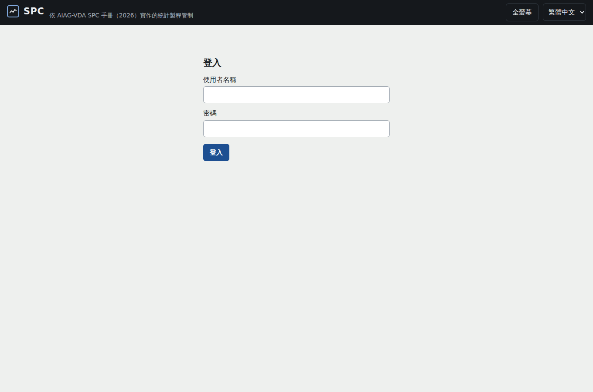

1. 輸入「使用者名稱」與「密碼」，按「登入」。
2. 第一次登入，或管理員重設過密碼後，程式會要求先「變更密碼」。
   - 密碼至少 10 個字元，且不可與使用者名稱相同。
3. 連續輸錯 5 次，該帳號鎖定 15 分鐘。急用時請管理員「解除鎖定」。
4. 閒置 2 小時，或登入超過 12 小時，會自動登出。請重新登入。

### 1.3 畫面配置

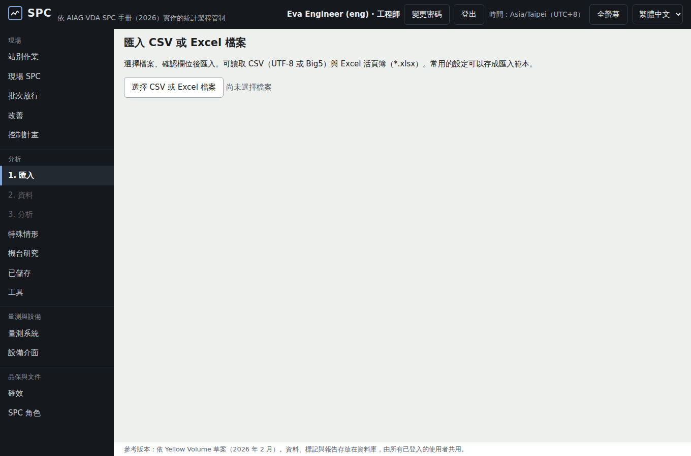

- **上方列**：目前使用者、變更密碼、登出、時區、全螢幕、語言切換（繁中／English）。
- **時區**：上方列顯示「時間：Asia/Taipei（UTC+8）」這類文字。畫面上所有時間都以這個時區顯示；資料庫一律以 UTC 保存。
- **左側導覽**：分成五組。看不到某個分頁，表示您的角色沒有權限。

| 群組 | 分頁 |
|---|---|
| 現場 | 站別作業、現場 SPC、批次放行、改善、控制計畫 |
| 分析 | 1. 匯入、2. 資料、3. 分析、特殊情形、機台研究、已儲存、工具 |
| 量測與設備 | 量測系統、設備介面 |
| 品保與文件 | 確效、SPC 角色 |
| 系統 | 管理（只有管理員看得到） |

### 1.4 角色與權限

登入角色由管理員指定。上一級角色擁有下一級的所有權限。

| 角色 | 可以做的事 |
|---|---|
| 檢視者 | 查看與分析，不能修改資料 |
| 操作員 | 在站別輸入量測值、處理警報、換班換批、記錄批次與處置 |
| 組長 | 確認首件、放行新批 |
| 工程師 | 匯入資料、標記、分析、產生報告；建立監控、量測系統、控制計畫、研究、改善、設備連線；確效 |
| 管理員 | 管理使用者、稽核紀錄、客戶專屬設定、受信任簽署者；刪除任何資料 |

- 「SPC 角色」（品質規劃、製程規劃等 7 種）和登入角色是分開的，用於核准控制計畫，見 6.3。
- 所有標記、處置、核准都記在登入者的名下，並寫入稽核紀錄。不能代替別人操作，請勿共用帳號。

---

## 2. 操作員：站別作業

左側「現場」→「站別作業」。這是現場最常用的畫面，適合觸控螢幕。

### 2.1 選擇站別

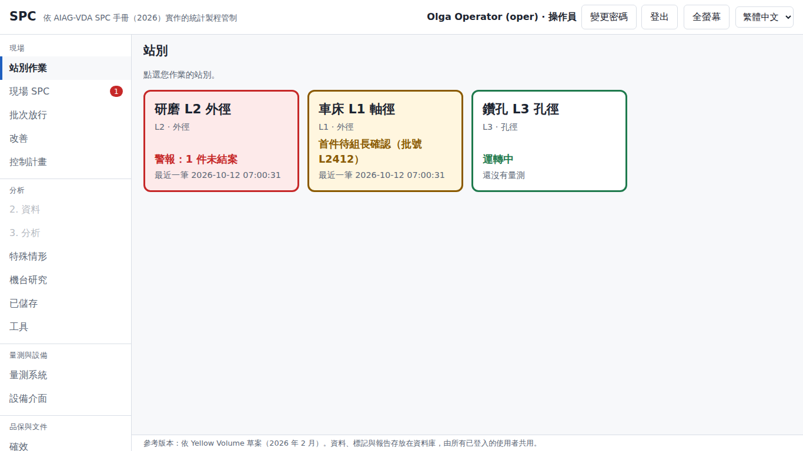

- 畫面列出所有站別。每一站以顏色、形狀與文字表示狀態：

| 狀態 | 意義 |
|---|---|
| 運轉中（受控） | 正常 |
| 警報：n 件未結案 | 有警報要處理 |
| 待量首件 | 換批後要先量首件 |
| 首件待組長確認 | 首件合格，等組長確認 |
| 已停用 | 工程師已停用這個監控 |

- 點選您作業的站別。
- 如果畫面顯示「還沒有設定站別」，請工程師在「現場 SPC」建立監控（見第 4 章）。

### 2.2 確認處置計畫

- 第一次進入某站，或工程師修改過處置計畫後，畫面會顯示該站的「失控反應計畫」。
- 讀完後按「我了解反應計畫」，才能輸入量測值。

### 2.3 輸入量測值

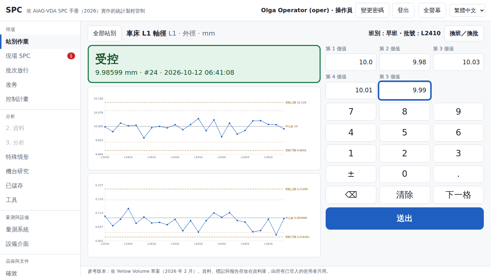

1. 畫面上方的大色塊顯示目前狀態：受控、警告、警報：需要處理，或尚無量測。
2. 用螢幕數字鍵或鍵盤輸入每一個量測值。按「下一格」換到下一個值，按「清除」重填。
3. 全部輸入後按「送出」。
4. 結果會立刻顯示：

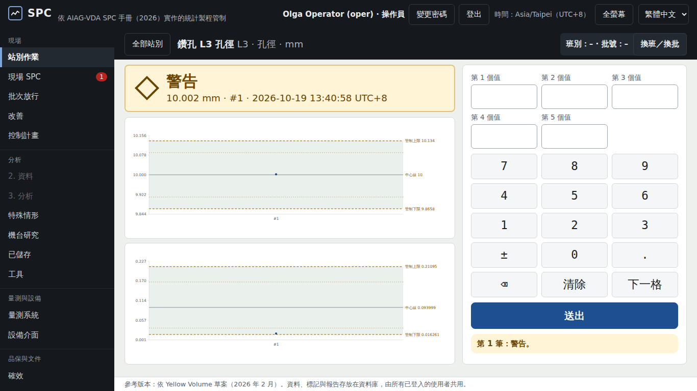

- 「第 n 筆在界限內。」：繼續生產。
- 「第 n 筆：警告。」：注意，依處置計畫留意下一筆。
- 「第 n 筆：警報！請立即處理。」：依 2.4 處理。

### 2.4 處理警報

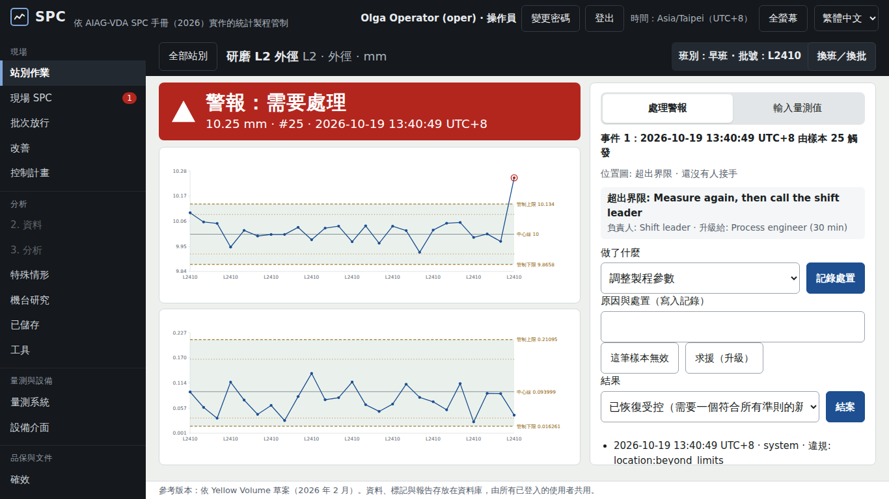

警報發生後，畫面切換到「處理警報」。依處置計畫執行，並記錄每一步：

1. 在「做了什麼」選擇步驟，例如：重複取樣、調整製程參數、調整製程元件（夾具、導件、刀具）、圍堵產品（篩選）、根本原因分析。
2. 在「原因與處置」寫下做了什麼，按「記錄處置」。
3. 如果是量錯、樣本拿錯，按「這筆樣本無效」並寫明原因。
4. 自己處理不了時，按「求援（升級）」。處置計畫寫了要找誰、多久內升級。超過時間沒有升級，事件會標示為逾期。
5. 處置後再量一個新樣本。新樣本符合所有準則後，選擇「結果」並按「結案」。

注意：

- 必須先記錄措施，並有一個符合所有準則的新樣本，事件才能以「已恢復受控」結案。
- 所有紀錄都寫上您的姓名與時間，之後不能修改。

### 2.5 換班或換批

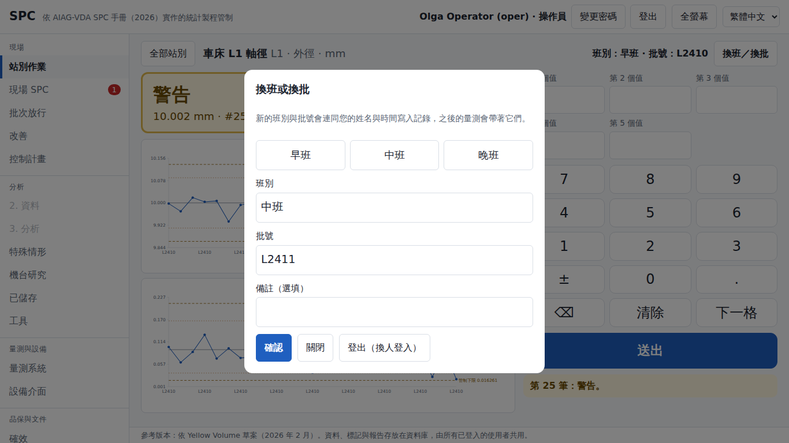

1. 按「換班／換批」。
2. 選擇「班別」（早班、中班、晚班），填寫「批號」，需要時填「備註」。
3. 按「確認」。之後的量測都會帶著這個班別與批號。

### 2.6 首件

如果工程師為這一站開啟了首件檢查：

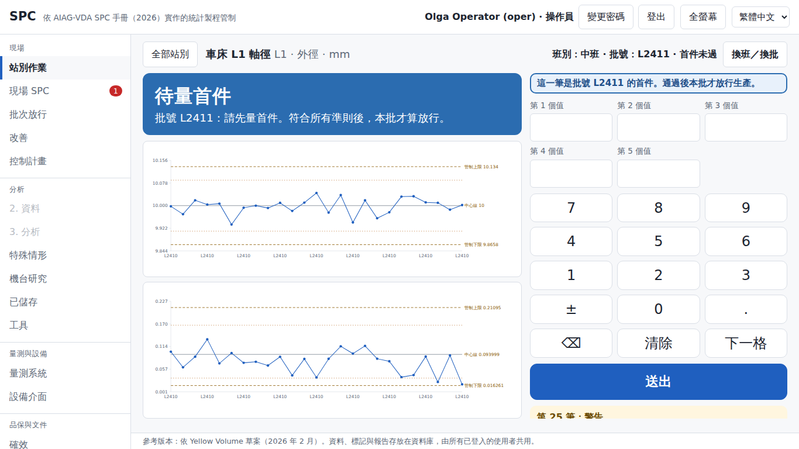

1. 換批後，畫面顯示「待量首件」。
2. 照常輸入量測值並送出。
   - 首件合格：本批放行，或顯示「組長確認後，本批才放行」，等組長確認（見第 3 章）。
   - 首件未通過：先處理警報或警告，再重新量首件。
3. 等組長確認期間，不能再輸入量測值。

### 2.7 新週期（換刀、修整）

- 有趨勢的製程（例如刀具磨耗）在換刀、換液之後，請勾選「新週期」，並在「發生了什麼事」寫明原因，再送出這一筆。

### 2.8 換人

- 換人操作時，按「登出（換人登入）」，讓下一位用自己的帳號登入。

---

## 3. 組長：首件確認

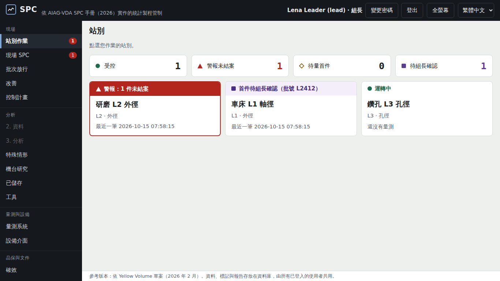

- 「站別作業」上方會顯示「n 件首件等組長確認」。標示「首件待組長確認」的站就是要處理的站。

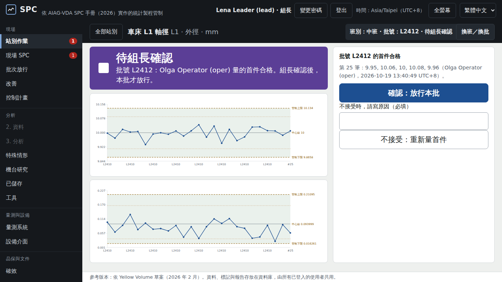

1. 點選該站，檢查首件的量測值、量測者與時間。
2. 接受：按「確認：放行本批」。
3. 不接受：在「不接受時，請寫原因」填寫原因，按「不接受：重新量首件」。

- 首件是您自己量的，就不能由您確認，必須由另一個人確認。

---

## 4. 工程師：建立與管理現場 SPC

左側「現場」→「現場 SPC」。

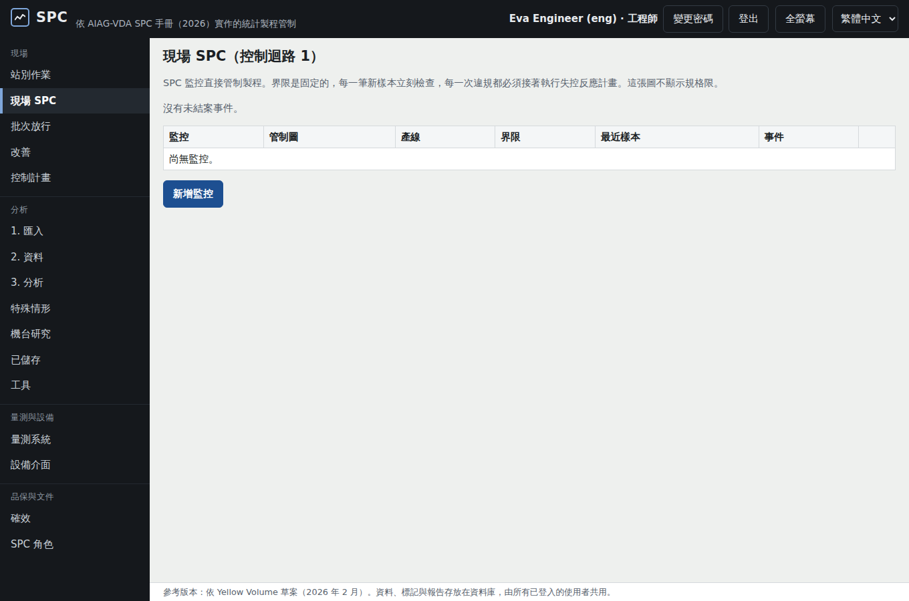

### 4.1 新增監控

按「新增監控」，填寫：

| 欄位 | 說明 |
|---|---|
| 監控名稱、製程、特性、單位、產線或機台 | 現場看到的站別名稱與說明 |
| 管制圖 | 例如 X̄-s、X̄-R、中位數與 R、I-MR、p、np、c、u、驗收圖、預控制圖、CUSUM、EWMA、Z-MR、T²、MEWMA、MCUSUM、延伸界限、Pearson、自迴歸殘差、多串流 |
| 每個樣本的量測數 (n) | 子組大小 |
| 管制界限的風險 | 一般用 3 個標準差 |
| 警告界限的風險 | 留空表示不設警告界限 |
| 第一版界限的來源 | 預期的製程參數（平均與標準差）、已儲存的資料集，或此監控自己的樣本 |
| 規格 | 只用於持續績效報告。現場的管制圖不顯示規格限 |
| 管制界限以外的穩定性準則 | 連串、趨勢等。每多一條準則，誤報也會增加，只開製程需要的 |
| 失控反應計畫（OCAP） | 每條準則違規時操作員做什麼、負責人、升級給誰、多久後升級 |
| 首件 | 換批後必須先量首件；可再要求組長確認 |
| 每個人輸入樣本前必須先確認反應計畫 | 建議開啟 |
| 這個監控使用中 | 取消勾選即停用 |

按「儲存」。監控會出現在操作員的「站別作業」中。

### 4.2 管制界限與歷史

- 界限是固定的，不會隨新資料自動變動。
- 製程的位置或變異因改善而改變，或檢討後發現界限不合適時，才按「設定新界限」並寫明理由。每次設定都會產生新版次，舊版本保留。

### 4.3 持續績效與能力

1. 在監控頁的「持續績效與能力」填寫「最近的樣本數」，按「計算」。
2. 結果顯示指標、穩定性與象限：
   - 象限 I：有能力且穩定。
   - 象限 II：有績效但不穩定。
   - 象限 III：穩定但未達目標。
   - 象限 IV：不穩定且未達目標。
3. 按「為這個視窗製作報告」，可產生一般的研究報告。

### 4.4 事件通知

- 左側「現場 SPC」旁的數字是未結案事件數。
- 管理員可以設定 webhook，在事件發生或首件等待確認時送出通知（見 `INSTALLATION.md`）。

### 4.5 批次放行

左側「現場」→「批次放行」。操作員以上可以記錄批次、暫扣與處置；特採放行與重新開啟處置需要工程師。

1. 按「新增批次」，填寫批號、數量、產品、特性、製程的監控器，以及這批的第一個與最後一個點，按「記錄批次」。
2. 程式依監控器的證據判斷：
   - 沒有阻擋的證據：可放行。
   - 證據擋住放行：請全數挑選，或由工程師特採。
3. 在「處置」選擇：放行、全數挑選、重工、報廢、特採放行（工程師），填寫理由，按「記錄處置」。
4. 需要時可「暫扣」。工程師可以「重新開啟處置」。

### 4.6 改善循環

左側「現場」→「改善」。依 PDCA 四步：

1. 計畫：按「規劃改善」，選擇追蹤的監控器、KPI（Pk 或 P）與目標，寫下問題與計畫。
2. 實施：按「記錄實施」。
3. 驗證：按「以新的點驗證」，程式用實施後的新樣本判定 KPI 是否達標。
4. 處置：達標按「成為新標準」並寫下新標準（例如控制計畫或界限的版次）；未達標按「重擬計畫」。

---

## 5. 工程師：資料分析與報告

左側「分析」群組。流程是「1. 匯入」→「2. 資料」→「3. 分析」→ 報告。

### 5.1 匯入

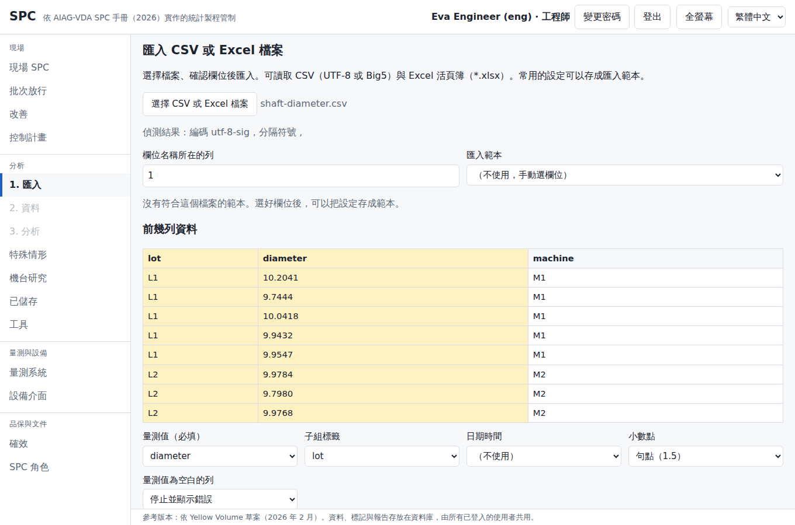

1. 按「選擇 CSV 或 Excel 檔案」。可讀 CSV（UTF-8 或 Big5）與 Excel（*.xlsx）。
2. 確認偵測到的編碼與分隔符號；Excel 檔請選工作表與「欄位名稱所在的列」。
3. 指定欄位：「量測值」必填；子組標籤、日期時間、標籤（人員、材料、方法、機台）等視需要選。
4. 量測值空白的列：選擇「停止並顯示錯誤」或「略過該列並註記」。
5. 按「匯入」。檔案有問題時，程式會列出行號與原因。
6. 常用的檔案格式可以「把這些設定存成匯入範本」，下次直接選用。

### 5.2 資料與離群值

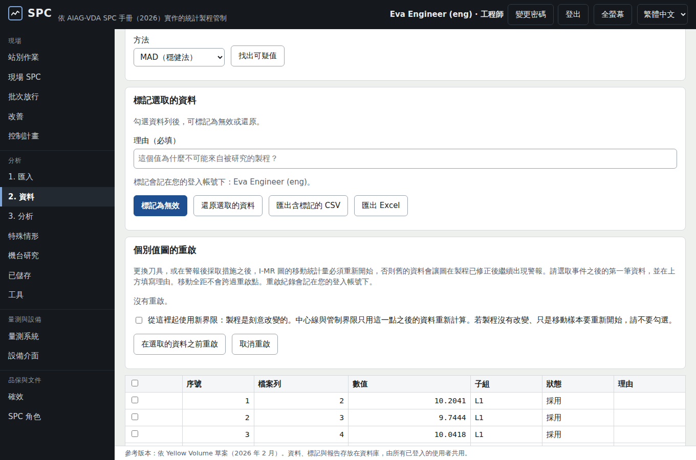

- 上方顯示總筆數、採用與無效筆數、子組數，以及來源檔的 SHA-256。
- **找可疑值**：選擇方法（MAD、Tukey、Grubbs），按「找出可疑值」。這只是提示。
- **標記無效**：勾選資料列，填寫理由，按「標記為無效」。
  - 只有知道該值不可能來自這個製程（例如量測錯誤）時才標記。
  - 標記過的值仍保留，只是不納入計算。可以「還原選取的資料」。
- **I-MR 圖重啟**：換刀或警報處置後，選取事件後的第一筆，按「在選取的資料之前重啟」。製程是刻意改變的，再勾選「從這裡起使用新界限」。
- 「匯出含標記的 CSV」與「匯出 Excel」可以把資料連同標記帶走。

### 5.3 分析

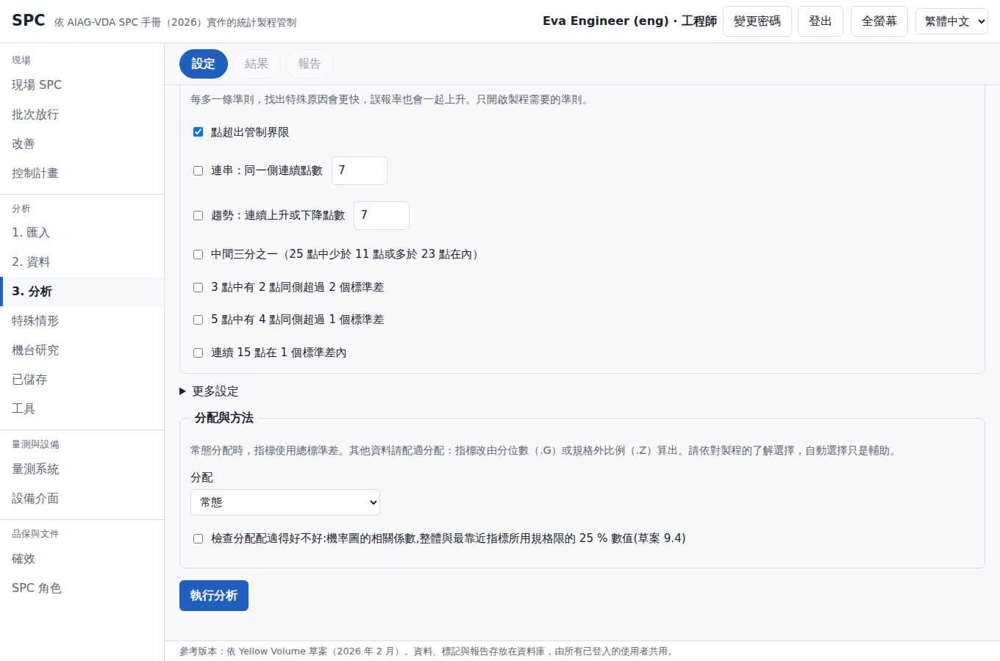

1. 「設定」分頁：
   - 研究階段：機器性能（Pm/Pmk）、初期製程性能（Pp/Ppk）、量產。
   - 管制圖：選「自動」，或指定圖種。
   - 規格上下限、特性分級（關鍵、重要、次要、其他）。
   - 穩定性判異準則：只開製程需要的準則。
   - 分配與方法：非常態資料選擇分配，或「自動選擇」。
   - 客戶專屬設定：選了之後，客戶協議的項目會鎖定。
2. 按「執行分析」。

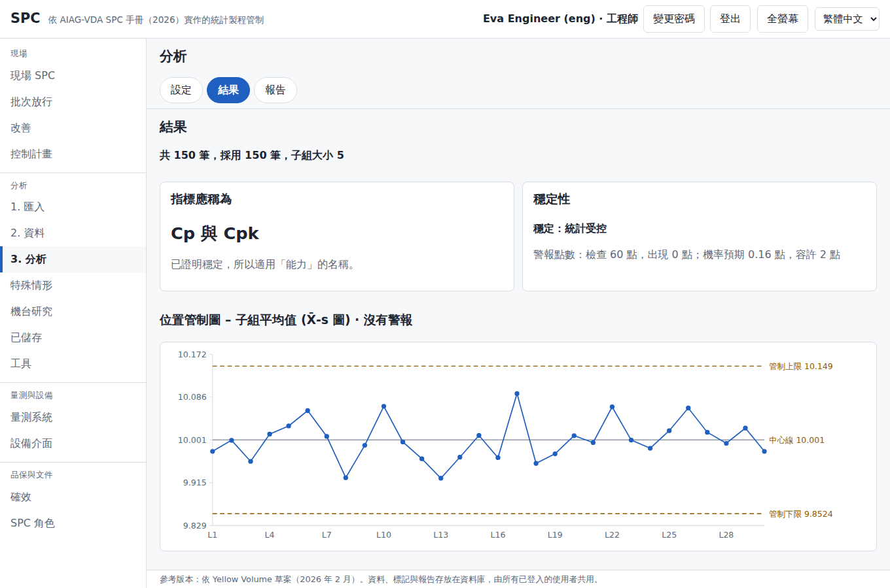

3. 「結果」分頁：管制圖、穩定性、指標名稱（Cp/Cpk 或 Pp/Ppk，依穩定性決定）、信賴區間、目標判定。

### 5.4 報告

1. 「報告」分頁：選擇報告語言，填寫製程、機器、人員、零件、特性等欄位。
2. 需要時加入已發行的控制計畫、多狀態機器性能、特殊情形、已結案的機台研究。
3. 按「產生報告」。
4. 可「開啟報告」、「下載 HTML」、「下載歸檔檔（JSON）」或下載 Excel。
5. 要 PDF：開啟報告後用瀏覽器列印（A4）。

- 報告是當下的快照，之後資料變動不會改變已產生的報告。
- 歸檔檔含資料、參數與結果，可用「工具」→「檢查歸檔檔」確認沒有被更動，並重新計算一次。

### 5.5 已儲存

- 「已儲存」列出所有資料集與報告，所有使用者共用。
- 資料集可「開啟」繼續分析，或「刪除」（由它產生的報告會保留）。
- 報告可開啟、下載、取得歸檔或 Excel 檔，也可以加外部簽章（見 6.6）。

---

## 6. 工程師：量測系統、控制計畫與品質文件

### 6.1 量測系統與 MSA 閘門

左側「量測與設備」→「量測系統」。

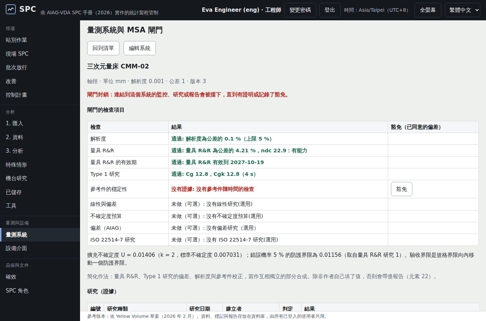

1. 按「新增量測系統」，填寫名稱、特性、單位、解析度、公差，以及閘門的判定標準。
2. 按「新增研究」加入量具 R&R、Type 1、穩定性、計數一致性等研究。
3. 閘門狀態：
   - 閘門開啟：可以使用。
   - 閘門有條件：可以使用，但會被標示。
   - 閘門封鎖：連結到這個系統的監控不能輸入樣本，報告也會被拒絕。
4. 經同意的偏差可以記錄為豁免（附理由），會一直被標示。

### 6.2 控制計畫

左側「現場」→「控制計畫」。

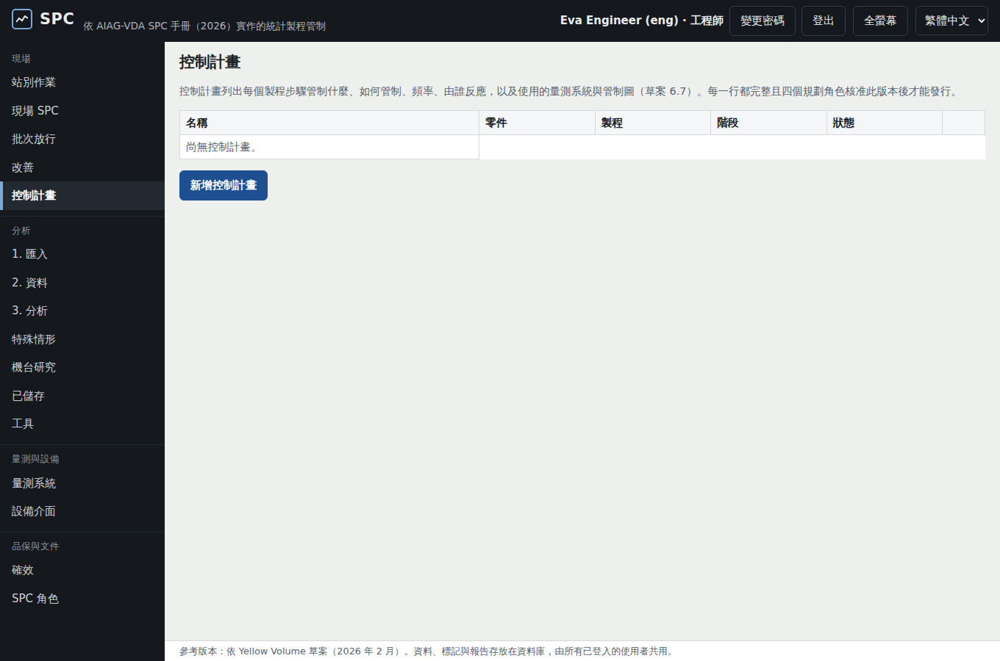

1. 按「新增控制計畫」，填寫名稱、零件、製程與階段（試量產前、安全量產、量產）。
2. 「新增項目」：每個製程步驟的特性、規格、管制方式、量測系統、監控、樣本數、頻率、反應計畫、負責角色。
3. 程式逐項檢查：完整性、規格、管制圖、反應、量測系統、不確定度等。
4. 所有項目通過且四個規劃角色都核准後，按「發行」。
   - 計畫一有變更，所有核准都會清除，要重新核准。
   - 只有擔任該 SPC 角色的人才能給出該角色的核准。

### 6.3 SPC 角色

左側「品保與文件」→「SPC 角色」。

- 依手冊表 6-1，為每個人指定 SPC 角色，並記錄能力等級（基礎、專家）與佐證（訓練、測驗、經驗）。
- 表格最後一列顯示每個角色有幾位合格人員。

### 6.4 機台研究

左側「分析」→「機台研究」。

1. 按「新增研究」，填寫機台、特性、工位，並連結資料集與量測系統。
2. 23 項檢查中，可以從資料判斷的會自動檢查；其他項目由工程師逐項確認並備註。
3. 全部完成後，按「結案」並寫結案說明。

### 6.5 確效

左側「品保與文件」→「確效」。

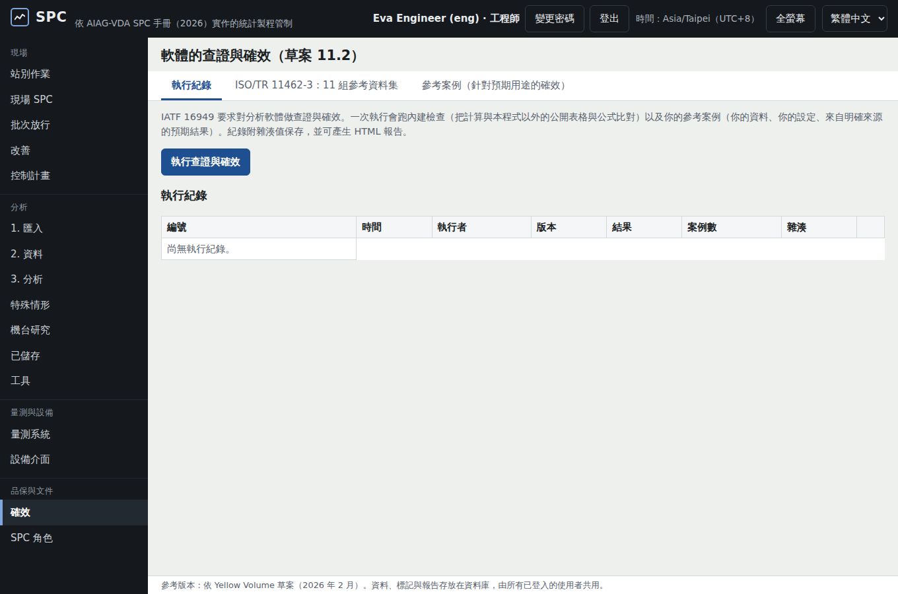

- 按「執行查證與確效」，程式執行內建的數百項檢查（含 ISO/TR 11462-3 的參考資料），並產生中英文報告。
- 「新增參考案例」可以加入貴公司自己的案例（資料、設定、預期結果及其來源）。沒有案例時，結果為「已查證，未確效」。
- 建議在安裝後、每次升級後各執行一次並保存報告。

### 6.6 外部簽章

- 在「已儲存」的報告按「簽章」，取得「待簽訊息」，用貴公司的簽章工具簽署，再貼上簽章與憑證或公開金鑰，按「驗證並新增」。
- 只有管理員列為「受信任簽署者」的金鑰，簽章才算受信任。

---

## 7. 工程師：其他工具

### 7.1 工具

左側「分析」→「工具」。

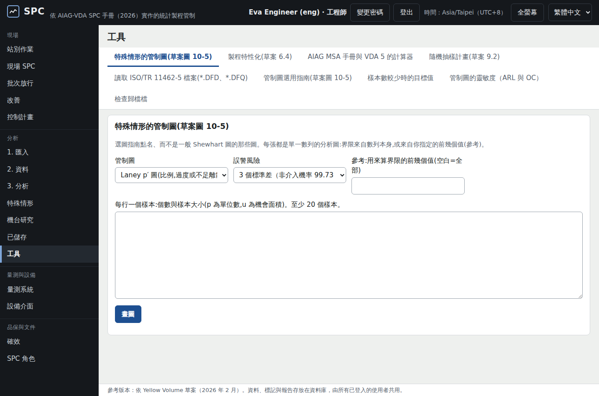

- 樣本數較少時的目標值。
- 管制圖的靈敏度（ARL 與 OC）：計算子組大小與抽樣間隔。
- 檢查歸檔檔。
- 特殊情形的管制圖、製程特性化（實驗設計，DOE）、MSA 計算器、管制圖選用指南。

### 7.2 特殊情形

左側「分析」→「特殊情形」：多段加工的檢驗範圍與組合、幾何公差的組裝間隙、多模穴、多維特性、巢狀變異成分、有趨勢的製程。結果可以放進報告的附錄 E。

### 7.3 設備介面（OPC UA）

左側「量測與設備」→「設備介面」。

1. 按「新增連線」，填寫伺服器位址、節點與對應的監控。
2. 按「測試讀取」，每個節點都讀到有效數值後，才能按「啟用」。
3. 設定有任何變動，都要重新測試。
4. 密碼不存在程式內，而是由管理員設定在伺服器的環境變數中。

### 7.4 SPC 健檢（命令列工具 `spc-check`）

用途：您已經有另一套 SPC 系統或試算表的資料，想知道那些管制圖有沒有在發揮作用。健檢工具讀一個檔案，在同一個資料夾寫出一份報告。它在本機執行，資料不會傳送到任何地方；不需要登入，也不需要啟動伺服器。

步驟：

1. 從原本的系統匯出資料（CSV 或 Excel）。一列一個量測值，或一列一個子組都可以。
2. 看檔案有哪些欄位：`spc-check 檔案.csv --columns`
3. 指定欄位並執行：

   ```
   spc-check 檔案.csv --value 量測值 --characteristic 特性 --subgroup 子組 --time 時間 --lsl-col LSL --usl-col USL --lcl-col LCL --ucl-col UCL --action 處置
   ```

4. 用瀏覽器打開 `檔案.csv.spc-check.html`。要 PDF 時，用瀏覽器的列印功能。

| 選項 | 說明 |
|---|---|
| `--value` | 量測值的欄位（必要）。寫一次：一列一個值。寫多次：一列一個子組（例如 X1～X5） |
| `--characteristic` | 特性名稱的欄位。一個檔案有多個特性時使用 |
| `--subgroup` | 子組的欄位。沒有就當成單值 |
| `--time` | 日期時間的欄位 |
| `--lsl-col`、`--usl-col` | 規格界限的欄位；或用 `--lsl`、`--usl` 直接給數字 |
| `--lcl-col`、`--ucl-col`、`--cl-col` | 現用管制界限的欄位；或用 `--lcl`、`--ucl`、`--cl` 直接給數字 |
| `--alarm` | 原系統的警報欄位（是／否） |
| `--action` | 處置或備註的欄位。有文字就算有處置 |
| `--sheet`、`--header-row`、`--delimiter`、`--decimal`、`--encoding` | 讀檔的設定，與匯入功能相同 |
| `--lang` | 報告語言：`zh-TW`（預設）或 `en` |
| `--out`、`--json` | 報告的位置；另外輸出 JSON |
| `--target-pk` | 製程能力指數的目標（預設 1.33） |

報告的內容：

- 第一頁是給主管的摘要：幾張圖看不到製程變化、幾張圖的警報來自設定而不是製程、多少警報沒有處置紀錄。
- 每個特性一張圖：紅色虛線是檔案中的管制界限，藍色線是依數據算出的界限。
- 每項發現都寫明：發現了什麼（附數字）、建議怎麼做、依據的手冊章節。
- 附錄列出所有判斷門檻。

檢查的項目：

| 類別 | 項目 |
|---|---|
| 管制界限 | 直接用規格界限當管制界限；比製程實際變異寬很多或窄很多；中心線不在製程實際的位置 |
| 抽樣 | 子組之間的變異比組內大很多（例如巢狀抽樣：一批抽幾片、每片量幾點）；單值之間不獨立 |
| 製程 | 水準在某一點之後改變（這是製程的變化，不是圖的問題）；製程不穩定 |
| 警報 | 警報太多；警報沒有處置紀錄 |
| 製程能力 | 不穩定的製程算出的指數；指數未達目標 |
| 量測 | 解析度對公差或對製程變異來說太粗；同一個值連續出現很多次 |

限制：

- 只檢查計量值。計數值（不良數、缺點數）不在這一版。
- 檔案中的管制界限，視為圖上所畫數值（子組平均值或單值）的界限。
- 完全沒有問題的資料，仍約有 2～5 % 的特性會出現一項發現。報告是協助檢視的工具，不是判決。
- 報告不能取代製程知識：它指出用法哪裡有問題，原因與改法要由了解製程的人判斷。

---

## 8. 管理員

左側「系統」→「管理」。

### 8.1 使用者

- **新增使用者**：填寫使用者名稱、標記時顯示的姓名、角色與臨時密碼，按「建立使用者」。對方首次登入時必須變更密碼。
- **重設密碼**：給一個臨時密碼，對方下次登入時必須變更。
- **解除鎖定**：輸錯密碼被鎖定時使用。
- 離職人員請停用帳號，不要刪除，以保留紀錄。

### 8.2 稽核紀錄

- 列出登入、標記、處置、報告與使用者變更等紀錄，以雜湊鏈相連。
- 按「檢查雜湊鏈」確認紀錄沒有被修改。
- 建議定期把「最後雜湊值」與筆數抄存在別處；之後用「與保存的雜湊比對」可以確認紀錄沒有被截斷。

### 8.3 客戶專屬設定

- 每個客戶一份：固定的分析設定（風險、信賴水準、判異準則、目標值）與報告版面（抬頭、表單編號、標誌、額外欄位）。
- 每次修改版次加一。已產生的報告保存自己用過的版本，不受之後修改影響。

### 8.4 受信任簽署者

- 新增、啟用或停用可信任的簽章金鑰（見 6.6）。

### 8.5 伺服器端工作

備份、還原、升級、IQ/OQ、設定變更，都在伺服器上執行，請看 `INSTALLATION.md`。

---

## 9. 常見問題

| 問題 | 處理方式 |
|---|---|
| 看不到某個分頁 | 您的角色沒有權限。請管理員確認角色 |
| 站別畫面不能輸入 | 先按「我了解反應計畫」；或首件正等組長確認；或量測系統的 MSA 閘門封鎖 |
| 警報不能結案 | 需要先記錄措施，再輸入一個符合所有準則的新樣本 |
| 帳號被鎖定 | 等 15 分鐘，或請管理員解除鎖定 |
| 時間看起來不對 | 上方列顯示的是工廠設定的時區。時區由管理員在伺服器設定 |
| 報告和現在的資料不同 | 報告是產生當下的快照，這是正常的 |
| 要 PDF | 開啟 HTML 報告後，用瀏覽器列印成 PDF（A4） |
| 指標名稱是 Pp/Ppk 而不是 Cp/Cpk | 製程沒有證明穩定時，程式一律稱為 Pp/Ppk |

---

## 10. 名詞說明

| 名詞 | 說明 |
|---|---|
| 監控 | 現場使用的管制圖，界限固定，每筆樣本立即檢查 |
| 管制界限 | 由製程變異算出的界限，判斷製程是否穩定 |
| 規格限 | 客戶或設計要求的公差，用於能力指標，不畫在現場管制圖上 |
| 失控反應計畫（OCAP） | 管制圖出現警報時，該做什麼、誰負責、何時升級 |
| 事件 | 一次警報從發生到結案的完整紀錄 |
| 首件 | 換批後的第一個樣本，合格後才放行本批 |
| MSA 閘門 | 量測系統能力不足時，自動擋下監控與報告 |
| Cp/Cpk、Pp/Ppk | 製程能力與製程性能指標 |
| Pm/Pmk | 機器性能指標 |
| 歸檔檔 | 報告的 JSON 檔，含資料、參數與雜湊，可檢查是否被更動 |
| 稽核紀錄 | 所有重要操作的紀錄，以雜湊鏈相連 |
